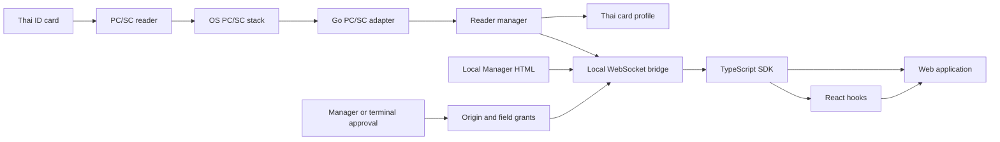

# Architecture

OpenThaiID is a JavaScript library for existing clinic ERP pages, plus a
local read-only helper that talks to a PC/SC reader over loopback
WebSocket. There is no hosted OpenThaiID frontend or backend.

## Goals

- Predictable web access to selected Thai ID textual fields. The default
  grant is `citizenId`, `thaiName`, and `birthDate`; remaining textual
  fields (`englishName`, `gender`, `issuer`, `issueDate`, `expireDate`,
  `address`) are opt-in and returned only when granted.
- Explicit operator approval for each new origin and field set (helper page
  staff Allow, or terminal; technician tools do not bypass this).
- No card-data persistence, telemetry, or cloud dependency.
- Hardware behavior separated from browser behavior so synthetic backends can
  exercise the full bridge.
- Clinic ERP integration as a JS library (`probeThaiID`, `autofillThaiID`)
  with no extra website to install.
- A loopback HTML page on the helper: clinic-staff Ready view plus hidden
  technician tools for Allow/Deny and diagnostics (the ERP cannot approve
  itself).
- A tray / background helper so clinic PCs do not need a developer terminal
  (Windows/macOS notification area; Linux background + `.desktop`).
- Opt-in start-at-login (`openthaiid autostart`); off by default.

## Non-goals (MVP)

- Biometrics, PIN bypass, card writes, arbitrary APDUs.
- Portraits / photo binary, laser-id / NHSO profiles.
- Signed / notarized store installers and auto-update.
- Persistent trust across bridge restarts.
- Official Firefox or Safari support.
- A hosted multi-tenant OpenThaiID backend.

## Process model

One Go process owns:

1. A reader-monitoring loop (separate PC/SC context).
2. A single bounded native read worker (serialized card connection).
3. An in-memory authorization module (origin grants + sessions).
4. A loopback HTTP server: helper page (`/`, `/v1/manager/*`) plus
   WebSocket (`/v1/ws`, subprotocol `openthaiid.v1`). The default HTML view
   is clinic-staff status; technician controls are toggled, not the home
   screen. `GET /v1/helper/summary` is staff-safe lights (no personal data);
   `POST /v1/helper/shutdown` is loopback-only and rejects foreign `Origin`.
5. A terminal command loop for approvals and revocation (console mode).
6. Optional tray / background mode (`openthaiid tray`) instead of the
   terminal loop.

## Module layout

| Path | Responsibility |
|---|---|
| `cmd/openthaiid` | Startup, flags, tray/autostart/status/quit, wiring |
| `internal/desktop` | Tray host, login-item files, staff-safe status text |
| `internal/card` | Field types, profiles, APDU handling, decoding |
| `internal/reader` | Reader inventory, card generations, read coordination |
| `internal/pcsc` | OS PC/SC adapter and native resource ownership |
| `internal/auth` | Pending approvals, origin grants, sessions, revocation |
| `internal/protocol` | Versioned browser messages and validation |
| `internal/bridge` | Loopback listener, Manager HTML, WebSocket connections, dispatch |
| `internal/config` | Typed configuration and validation |
| `sdk/web` | `@openthaiid/web` browser SDK |
| `sdk/react` | `@openthaiid/react` hooks wrapping `@openthaiid/web` |
| `examples/vanilla` | Minimal demonstration app |
| `examples/clinic-patient` | Create-patient ERP sample (`autofillThaiID` settings object) |
| `examples/react` | Copy-paste React usage |

There is no public Go `pkg/thaiid` in the MVP. Extract one when a real native
consumer establishes interface requirements.

## Concurrency and resource ownership

- Monitoring and reading use separate PC/SC contexts.
- Native operations on one connection are serialized.
- One active read across the bridge; competitors receive `BUSY` (never queued).
- A single native worker owns open → transaction → transmit → end → close.
- A Go context deadline does not interrupt a blocked native transmit. On
  cancel/timeout the logical request returns `CANCELLED` or `READ_TIMEOUT`
  promptly; late native results are discarded; the global read slot stays
  occupied until that worker finishes cleanup.
- If native work is still blocked two seconds after cancellation, the backend
  is marked `BACKEND_STALLED` until the worker finishes and monitoring
  recovery completes.
- Shutdown never releases a PC/SC context still owned by a worker; it returns
  at its deadline instead.
- Each WebSocket connection allows at most eight concurrent asynchronous
  operations. Excess requests receive `RATE_LIMITED`. `session.close` and
  `request.cancel` stay synchronous and responsive.
- Slow clients or an overflowed reader-event queue close the socket with
  WebSocket status 1013; reconnect obtains a fresh snapshot.

## State dimensions

| Dimension | States |
|---|---|
| Connection | `disconnected`, `connecting`, `awaiting-approval`, `connected`, `reconnecting` |
| Backend | `available`, `unavailable`, `stalled` |
| Reader | `ready`, `unavailable` |
| Card presence | `absent`, `present`, `unsupported` |
| Read operation | `idle`, `reading`, `failed` |

Every insertion receives an opaque `cardSessionId`. It is invalidated on
removal, reader loss, card reset, or uncertain continuity after recovery.
Successful reads return a result and leave the operation `idle`; there is no
sticky global “card-ready” result.

## Design constraints

- No generic plugin framework, DI container, event bus, or repository
  abstraction.
- Websites cannot supply APDU bytes or memory offsets.
- Only explicitly requested fields are returned. Incidental adjacent bytes are
  discarded.
- Read results are unicast to the requesting connection.
- Protocol major versions are negotiated; unknown operations are rejected.
