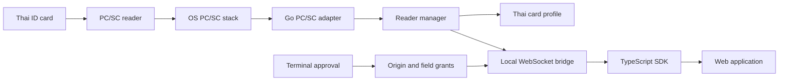

# Architecture

OpenThaiID is a local, read-only bridge that exposes selected Thai National ID
card fields to browser applications over a loopback WebSocket.

## Goals

- Predictable web access to `citizenId`, `thaiName`, and `birthDate`.
- Explicit operator approval for each new origin and field set.
- No card-data persistence, telemetry, or cloud dependency.
- Hardware behavior separated from browser behavior so synthetic backends can
  exercise the full bridge.

## Non-goals (MVP)

- Biometrics, PIN bypass, card writes, arbitrary APDUs.
- Portraits, remaining demographic fields, React hooks, installers, tray UI.
- Persistent trust across bridge restarts.
- Official Firefox or Safari support.

## Process model

One Go process owns:

1. A reader-monitoring loop (separate PC/SC context).
2. A single bounded native read worker (serialized card connection).
3. An in-memory authorization module (origin grants + sessions).
4. A loopback WebSocket server (`/v1/ws`, subprotocol `openthaiid.v1`).
5. A terminal command loop for approvals and revocation.

## Module layout

| Path | Responsibility |
|---|---|
| `cmd/openthaiid` | Startup, flags, signals, wiring |
| `internal/card` | Field types, profiles, APDU handling, decoding |
| `internal/reader` | Reader inventory, card generations, read coordination |
| `internal/pcsc` | OS PC/SC adapter and native resource ownership |
| `internal/auth` | Pending approvals, origin grants, sessions, revocation |
| `internal/protocol` | Versioned browser messages and validation |
| `internal/bridge` | Loopback listener, WebSocket connections, dispatch |
| `internal/config` | Typed configuration and validation |
| `sdk/web` | `@openthaiid/web` browser SDK |
| `examples/vanilla` | Minimal demonstration app |

There is no public Go `pkg/thaiid` in the MVP. Extract one when a real native
consumer establishes interface requirements.

## Concurrency and resource ownership

- Monitoring and reading use separate PC/SC contexts.
- Native operations on one connection are serialized.
- One active read across the bridge; competitors receive `BUSY`.
- Queued reads that might later hit a different inserted card are refused.
- A Go context deadline does not interrupt a blocked native transmit. On
  timeout the logical request is cancelled, late native results are discarded,
  and the worker remains occupied until the call returns.
- Persistent driver hangs force a bridge restart. Replacement workers are never
  spawned unboundedly.

## State dimensions

| Dimension | States |
|---|---|
| Connection | `disconnected`, `connecting`, `awaiting-approval`, `connected`, `reconnecting` |
| Backend | `available`, `unavailable`, `stalled` |
| Reader | `ready`, `unavailable` |
| Card presence | `absent`, `present`, `unsupported` |
| Read operation | `idle`, `reading`, `failed` |

Every insertion receives an opaque `cardSessionId`. It is invalidated on
removal, reader loss, card reset, or uncertain continuity after recovery.
Successful reads return a result and leave the operation `idle`; there is no
sticky global “card-ready” result.

## Design constraints

- No generic plugin framework, DI container, event bus, or repository
  abstraction.
- Websites cannot supply APDU bytes or memory offsets.
- Only explicitly requested fields are returned. Incidental adjacent bytes are
  discarded.
- Read results are unicast to the requesting connection.
- Protocol major versions are negotiated; unknown operations are rejected.
